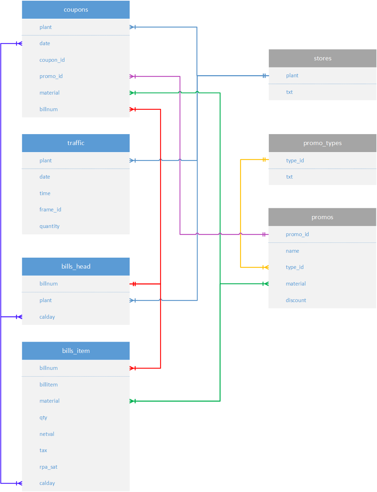
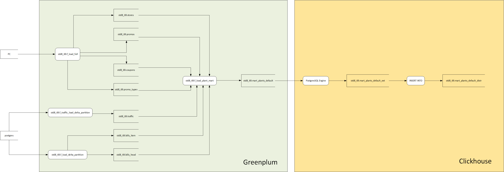

# Sales Analytics Platform

The project builds a store performance mart from receipts, foot traffic and promotions. PostgreSQL serves as a lightweight local warehouse, Greenplum SQL describes the target MPP model, and the finished mart is published to ClickHouse for BI.

The first version was my capstone project for the Sapiens Solutions Greenplum course. I later rebuilt it as a reproducible repository with tests and automated checks. `sample_data` holds a normalized extract from an anonymized training dataset rather than synthetic data.

## Data flow


Airflow orchestrates loading CSVs into PostgreSQL or Greenplum, building the store performance mart, and publishing the result to ClickHouse. After the SQL mart passes its checks, a PySpark stage rebuilds the same mart from the source tables, verifies it against the SQL version and writes it to a separate ClickHouse table. A lightweight Compose stack runs the same stages directly without pulling the full Airflow image. The DAG in `dags/` is meant for deploying the package into an existing Airflow environment.

The mart computes gross and net revenue, discounts, units and receipts sold, foot traffic, conversion, promo share and average check. The field is named `net_revenue` rather than profit: revenue after discounts is not accounting profit.

## Running the pipeline

Requires Docker with Compose.

```bash
docker compose up --build --abort-on-container-exit pipeline
```

The command creates the source tables and the warehouse layer, loads the data, builds `sales.mart_store_performance`, runs the checks, publishes the result to ClickHouse and runs the Spark stage.

Inspect the mart in PostgreSQL:

```bash
docker compose exec postgres psql -U sales -d sales -c \
  "select * from sales.mart_store_performance order by plant"
```

Inspect the table in ClickHouse:

```bash
docker compose exec clickhouse clickhouse-client --query \
  "select * from sales.mart_store_performance order by plant format PrettyCompact"
```

`docker compose down -v` stops the containers and removes the local stack data.

## Engineering decisions

In Greenplum, receipt headers and line items are distributed by `billnum`, small dimensions are replicated, and facts are partitioned by date and stored as append-optimized column tables. The local PostgreSQL does not emulate Greenplum's distribution. It exists to run the transformations and tests reproducibly.

The mart starts from the store dimension and attaches aggregates via `LEFT JOIN`, so a store does not disappear when traffic or promo data is missing. Duplicate coupons are resolved deterministically with `row_number()`.

Before publishing, the pipeline verifies:

- Uniqueness of business keys and the mart grain.
- Non-negative quantities, revenue, traffic and discounts.
- Referential integrity between receipt headers and line items.
- Revenue reconciliation against the source line items.
- Valid ranges for conversion and promo share.

Any failure stops the pipeline.

## Running individual stages

```bash
python -m sales_pipeline init
python -m sales_pipeline mart
python -m sales_pipeline publish
python -m sales_pipeline spark
python -m sales_pipeline all
```

Connection settings come from the variables in `.env.example`.

## Spark stage

`sales_pipeline/spark_mart.py` builds `sales.mart_store_performance` a second time with the PySpark DataFrame API:

1. Reads the seven source tables from PostgreSQL over JDBC. Greenplum uses the same protocol, so the PostgreSQL driver works against it as well.
2. Builds the mart from the store dimension with left joins, deduplicates coupons with a `row_number()` window in the same order as the SQL query, and applies the same formulas, rounding and `Decimal(18, 2)` / `Decimal(8, 2)` types.
3. Reads the SQL mart from PostgreSQL and compares the two row by row: the same set of stores and every numeric column within 0.01. Any difference stops the stage and names the stores and columns that diverged.
4. Writes the verified mart to `sales.mart_store_performance_spark` in ClickHouse through `com.clickhouse:clickhouse-jdbc`. The table created by `publish` is left untouched.

The build function takes DataFrames and does not know where they came from, so the tests run it on the CSV files in `sample_data` with a local Spark session and compare it with the SQL query executed in DuckDB.

Run it after the `mart` stage; it needs Java 17:

```bash
python -m pip install -e ".[spark]"
python -m sales_pipeline spark
```

`SPARK_MASTER` selects local mode or a cluster. `SPARK_JARS` points to local JDBC driver jars; when it is empty, Spark downloads `SPARK_PACKAGES` from Maven on start. The Docker image downloads both drivers at build time, pins them by checksum and sets `SPARK_JARS`, so a pipeline run does not depend on Maven being reachable. In Airflow the `build_spark_mart` task runs in parallel with `publish_to_clickhouse`.

Why Spark next to an MPP warehouse: with this data volume it is not needed for performance, and Greenplum is the right place for the mart. The stage shows the same mart computed outside the warehouse, for example when the sources live in files or several systems, and it cross-checks two independent implementations of the business logic. A mistake in a join or a formula would have to be made twice in the same way to pass the parity check.

## Layout

```text
dags/               Airflow DAG
docs/               diagrams and material from the original stack
sample_data/        normalized anonymized dataset
sales_pipeline/     stage runner, data quality checks, Spark mart and parity check
sql/marts/          portable mart query
sql/postgres/       local schema
sql/greenplum/      target MPP schema
tests/              mart, Spark mart, parity and configuration tests
```

## Checks

The Spark tests start a local Spark session and need Java 17.

```bash
python -m pip install -e ".[dev]"
pytest
ruff check .
ruff format --check .
```

## Data and illustrations

The dataset covers 15 anonymized stores over January and February 2021: 3,213 receipts, 10,516 aggregated receipt line items, 885 daily traffic records and 597 coupons. Duplicate rows from the source Excel file are grouped by receipt and material. That pair of fields serves as the business key of the warehouse table.

The source Excel file, notes and presentation are not published: they contained credentials for the training stack. The mapping between sheets and CSVs is described in [sample_data/README.md](sample_data/README.md).

The ER diagram and the Superset screenshot come from the original training environment. The old Airflow graph is kept as historical evidence and contains the training schema name; the maintained DAG and the local stack use neutral names.






