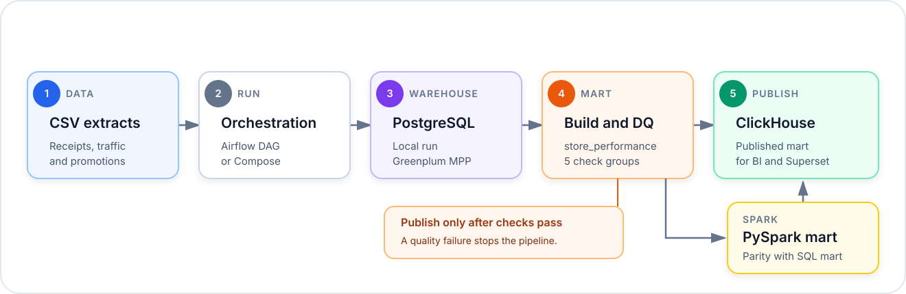
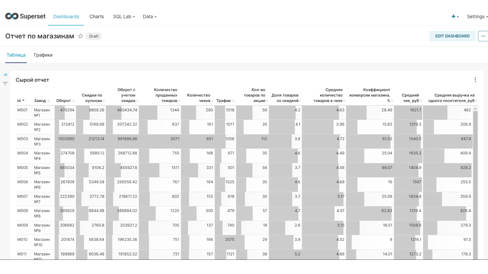

# Sales Analytics Platform

The project builds a store performance mart from receipts, foot traffic and promotions. PostgreSQL serves as a lightweight local warehouse, Greenplum SQL describes the target MPP model, and the finished mart is published to ClickHouse for BI.

The first version was my capstone project for the Sapiens Solutions Greenplum course. I later rebuilt it as a reproducible repository with tests and automated checks. `sample_data` holds a normalized extract from an anonymized training dataset rather than synthetic data.

## Data flow



Airflow orchestrates loading CSVs into PostgreSQL or Greenplum, building the store performance mart, and publishing the result to ClickHouse. A lightweight Compose stack runs the same stages directly without pulling the full Airflow image. The DAG in `dags/` is meant for deploying the package into an existing Airflow environment.

The mart computes gross and net revenue, discounts, units and receipts sold, foot traffic, conversion, promo share and average check. The field is named `net_revenue` rather than profit: revenue after discounts is not accounting profit.

## Running the pipeline

Requires Docker with Compose.

```bash
docker compose up --build --abort-on-container-exit pipeline
```

The command creates the source tables and the warehouse layer, loads the data, builds `sales.mart_store_performance`, runs the checks and publishes the result to ClickHouse.

Inspect the mart in PostgreSQL:

```bash
docker compose exec postgres psql -U sales -d sales -c \
  "select * from sales.mart_store_performance order by plant"
```

Inspect the table in ClickHouse:

```bash
docker compose exec clickhouse clickhouse-client --query \
  "select * from sales.mart_store_performance order by plant format PrettyCompact"
```

`docker compose down -v` stops the containers and removes the local stack data.

## Engineering decisions

In Greenplum, receipt headers and line items are distributed by `billnum`, small dimensions are replicated, and facts are partitioned by date and stored as append-optimized column tables. The local PostgreSQL does not emulate Greenplum's distribution. It exists to run the transformations and tests reproducibly.

The mart starts from the store dimension and attaches aggregates via `LEFT JOIN`, so a store does not disappear when traffic or promo data is missing. Duplicate coupons are resolved deterministically with `row_number()`.

Before publishing, the pipeline verifies:

- Uniqueness of business keys and the mart grain.
- Non-negative quantities, revenue, traffic and discounts.
- Referential integrity between receipt headers and line items.
- Revenue reconciliation against the source line items.
- Valid ranges for conversion and promo share.

Any failure stops the pipeline.

## Running individual stages

```bash
python -m sales_pipeline init
python -m sales_pipeline mart
python -m sales_pipeline publish
python -m sales_pipeline all
```

Connection settings come from the variables in `.env.example`.

## Layout

```text
dags/               Airflow DAG
docs/               diagrams and material from the original stack
sample_data/        normalized anonymized dataset
sales_pipeline/     stage runner and data quality checks
sql/marts/          portable mart query
sql/postgres/       local schema
sql/greenplum/      target MPP schema
tests/              mart and configuration tests
```

## Checks

```bash
python -m pip install -e ".[dev]"
pytest
ruff check .
ruff format --check .
```

## Data and illustrations

The dataset covers 15 anonymized stores over January and February 2021: 3,213 receipts, 10,516 aggregated receipt line items, 885 daily traffic records and 597 coupons. Duplicate rows from the source Excel file are grouped by receipt and material. That pair of fields serves as the business key of the warehouse table.

The source Excel file, notes and presentation are not published: they contained credentials for the training stack. The mapping between sheets and CSVs is described in [sample_data/README.md](sample_data/README.md).

The ER diagram and the Superset screenshot come from the original training environment. The old Airflow graph is kept as historical evidence and contains the training schema name; the maintained DAG and the local stack use neutral names.



